# Production Three-Tier Web Application Deployment on Microsoft Azure

[](https://azure.microsoft.com/)
[](https://ubuntu.com/)
[](https://nextjs.org/)
[](https://nodejs.org/)
[](https://azure.microsoft.com/)
[](https://nginx.org/)
[](https://azure.microsoft.com/)

---

## Table of Contents
1. [Executive Summary & Scenario](#1-executive-summary--scenario)
2. [End-to-End Architectural Blueprint](#2-end-to-end-architectural-blueprint)
3. [Network Segmentation & IP Addressing Scheme](#3-network-segmentation--ip-addressing-scheme)
4. [Task 1: Architecture Design & Implementation Strategy](#task-1-architecture-design--implementation-strategy)
5. [Task 2: Azure Network Foundation Deployment](#task-2-azure-network-foundation-deployment)
6. [Task 3: Security & Network Access Control](#task-3-security--network-access-control)
7. [Task 4: Deploy Managed Database Tier (Azure MySQL Flexible Server)](#task-4-deploy-managed-database-tier-azure-mysql-flexible-server)
8. [Task 5: Deploy Application Tier (Private App VM)](#task-5-deploy-application-tier-private-app-vm)
9. [Task 6: Deploy Presentation Tier (Web VM & Nginx Reverse Proxy)](#task-6-deploy-presentation-tier-web-vm--nginx-reverse-proxy)
10. [Upcoming Implementation Phases (Tasks 7–8)](#upcoming-implementation-phases-tasks-78)
11. [Author & Engineering Profile](#author--engineering-profile)

---

## 1. Executive Summary & Scenario

### Real-World Business Context
Modern cloud architectures require strict isolation between public presentation layers, internal business logic, and backend databases. In this enterprise project, the **Book Review Application** is migrated and deployed into a production-grade, highly secure, three-tier environment on **Microsoft Azure**.

The deployment enforces zero direct public ingress to backend compute and database tiers, implements managed egress routing via Azure NAT Gateway, provides resilient layer-4 traffic distribution through dual Azure Load Balancers (Public and Internal), and enforces end-to-end least-privilege access control.

### Key Engineering Objectives
* **Logical & Network Segmentation:** Isolate Presentation, Application, and Database tiers across distinct, non-overlapping Virtual Network subnets.
* **Controlled Public Ingress:** Expose only an Azure Standard Public Load Balancer to the public internet on TCP port 80.
* **Zero Public Exposure for Backend & Database:** The Application VM possesses no Public IP address; the Azure Database for MySQL Flexible Server operates with private access only inside a delegated subnet.
* **Controlled Outbound Internet Egress:** Provide package updates (`apt`), Node runtime packages (`npm`), and repository downloads via an Azure NAT Gateway without allowing unsolicited inbound traffic.
* **Bastion Jump Host Administration:** Restrict administrative SSH access to the Web VM, and manage the private App VM exclusively via SSH ProxyJump (`-J`).
* **Resilient Internal Routing:** Route all frontend-to-backend API traffic through an Azure Standard Internal Load Balancer assigned a reserved private IP (`10.0.2.10:3001`).

---

## 2. End-to-End Architectural Blueprint

### Architecture Diagram
The diagram below illustrates the complete component topology, network boundaries, security perimeters, and bidirectional traffic flow.

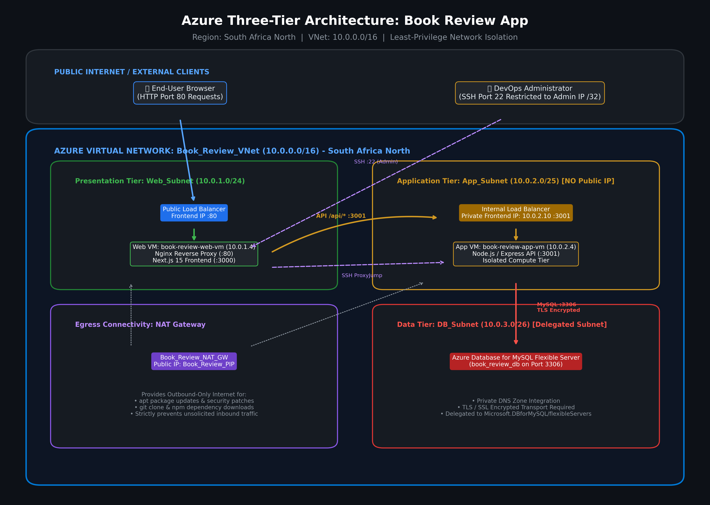

### High-Level Topology Walkthrough
```mermaid
flowchart TD
    subgraph Internet ["Public Internet"]
        User["End-User Client Browser"]
        Admin["DevOps Workstation (Admin)"]
    end

    subgraph Azure ["Microsoft Azure Cloud (South Africa North) | BookReview_RG"]
        subgraph VNet ["Virtual Network: Book_Review_VNet (10.0.0.0/16)"]
            
            subgraph WebTier ["Presentation Tier: Web_Subnet (10.0.1.0/24)"]
                PubLB["Azure Public Load Balancer<br/>Frontend PIP :80"]
                WebVM["Web VM: book-review-web-vm (10.0.1.4)<br/>• Nginx Reverse Proxy (:80)<br/>• Next.js 15 SSR/SPA (:3000)"]
            end

            subgraph AppTier ["Application Tier: App_Subnet (10.0.2.0/25)"]
                IntLB["Azure Internal Load Balancer<br/>Private Frontend IP: 10.0.2.10 :3001"]
                AppVM["App VM: book-review-app-vm (10.0.2.4)<br/>• NO Public IP Address<br/>• Node.js / Express API (:3001)<br/>• Managed by PM2 Runtime"]
            end

            subgraph DBTier ["Data Tier: DB_Subnet (10.0.3.0/26)"]
                MySQL["Azure Database for MySQL Flexible Server<br/>• Private Access & DNS Zone<br/>• Port 3306 (SSL/TLS Required)<br/>• Database: book_review_db"]
            end

            NAT["Azure NAT Gateway: Book_Review_NAT_GW<br/>Public IP: Book_Review_PIP (4.221.200.108)<br/>(Outbound Updates for Web & App Subnets)"]
        end
    end

    %% Ingress Flow
    User -->|HTTP :80| PubLB
    PubLB -->|Forward TCP :80| WebVM
    WebVM -->|Local Loopback Proxy :3000| WebVM
    WebVM -->|API Route /api/* :3001| IntLB
    IntLB -->|Forward TCP :3001| AppVM
    AppVM -->|MySQL Protocol :3306 (TLS Enforced)| MySQL

    %% Egress Flow
    WebVM -.->|Outbound Egress Only| NAT
    AppVM -.->|Outbound Egress Only| NAT

    %% Administrative Flow
    Admin -->|SSH :22 Direct| WebVM
    Admin -.->|SSH ProxyJump -J via Web VM| AppVM
```

---

## 3. Network Segmentation & IP Addressing Scheme

The Virtual Network uses the classless inter-domain routing (CIDR) block `10.0.0.0/16`. It is segmented into three non-overlapping subnets sized according to workload characteristics, scalability requirements, and Azure-reserved IP constraints:

| Subnet Name | CIDR Block | Total IPs | Azure Reserved IPs | Usable Host IPs | Purpose & Associated Resources | Subnet NSG | Delegation |
| :--- | :--- | :--- | :--- | :--- | :--- | :--- | :--- |
| **`Web_Subnet`** | `10.0.1.0/24` | 256 | 5 | 251 | Public Load Balancer backend pool, Web VM (`10.0.1.4`) | `Web_NSG` | None |
| **`App_Subnet`** | `10.0.2.0/25` | 128 | 5 | 123 | Internal Load Balancer (`10.0.2.10`), Private App VM (`10.0.2.4`) | `App_NSG` | None |
| **`DB_Subnet`** | `10.0.3.0/26` | 64 | 5 | 59 | Azure Database for MySQL Flexible Server & Private DNS | `DB_NSG` | `Microsoft.DBforMySQL/flexibleServers` |

> **Azure Subnet Address Reservation Rule:** In any Azure Virtual Network subnet, Azure reserves the first four IP addresses (`.0` network, `.1` default gateway, `.2`/`.3` Azure DNS mapping) and the last IP address (`.255` broadcast) for cloud platform operations.

---

## Task 1: Architecture Design & Implementation Strategy

### 1.1 Strategic Design Decisions
* **Cloud Region Selection:** `South Africa North`. Selected based on validated capacity for burstable compute (`Standard_B2s_v2` / `Standard_B2ats_v2`), Azure MySQL Flexible Server burstable SKUs (`Standard_B1ms`), and minimal regional latency.
* **Compute Capacity Planning:** Ubuntu 24.04 LTS instances running on dual-core burstable VMs (`Standard_B2s_v2` / `Standard_B2ats_v2`). This configuration provides adequate memory (4 GiB) and burstable CPU credits to compile Next.js production builds and execute Node.js Express workloads without memory exhaustion.
* **High Availability & Single-Instance Tradeoff:** For this deployment capstone, one Virtual Machine is deployed per compute tier. Azure Standard Load Balancers monitor target instances via TCP health probes. While a single VM per tier introduces a maintenance window during virtual machine restart, the architecture is designed to scale horizontally into Azure Virtual Machine Scale Sets (VMSS) across multiple Availability Zones without architectural refactoring.
* **Database Sizing & Data Integrity:** Azure Database for MySQL Flexible Server provisioned with 32 GiB storage and 1-day automated point-in-time recovery backup retention. Enforced SSL/TLS encryption (`require_secure_transport = ON`) guarantees protection against eavesdropping on internal database connections.
* **Secret Management Strategy:** Application secrets (database credentials, JWT signing secrets, database host FQDN) are maintained in local `.env` configuration files with file permissions hardened to `chmod 600` (readable and writable only by the application owner). Sensitive values are excluded from Git version control via `.gitignore`.
* **Disaster Recovery & Operational Continuity:** Azure MySQL automated backups support point-in-time restoration. Application runtimes are supervised by PM2 process manager configured with systemd startup services to ensure automatic recovery upon instance restart.

### 1.2 Evidence of Execution
> **Screenshot 1:** Full three-tier architecture diagram displaying the public entry point, tier boundaries, network security isolation, and data flow paths.


---

## Task 2: Azure Network Foundation Deployment

### 2.1 Overview & Technical Purpose
Task 2 provisions the foundational networking infrastructure that supports all subsequent compute, load balancing, and database resources. Complete isolation between tiers is established at the network layer.

### 2.2 Provisioned Network Resources
The following resources were provisioned within the dedicated Resource Group:

1. **Dedicated Resource Group:**
   * **Name:** `BookReview_RG`
   * **Location:** `southafricanorth`
   * **Purpose:** Logical container encapsulating all network, compute, database, and load balancing assets for lifecycle and security management.

2. **Virtual Network (VNet):**
   * **Name:** `Book_Review_VNet`
   * **Address Space:** `10.0.0.0/16` (65,536 addresses)
   * **Location:** `southafricanorth`

3. **Subnet Segmentation & Delegation:**
   * **`Web_Subnet` (`10.0.1.0/24`):** Designated for the public-facing Nginx reverse proxy and Next.js frontend VM.
   * **`App_Subnet` (`10.0.2.0/25`):** Designated for the private Node.js/Express API VM and the Internal Load Balancer private frontend.
   * **`DB_Subnet` (`10.0.3.0/26`):** Dedicated exclusively to the Azure Database for MySQL Flexible Server. Delegated to `Microsoft.DBforMySQL/flexibleServers`, granting Azure Resource Provider permission to inject the managed database network interface directly into the private subnet.

4. **Internal Load Balancer Static IP Reservation:**
   * **Reserved IP:** `10.0.2.10` in `App_Subnet` (`10.0.2.0/25`).
   * **Purpose:** Serves as the static internal endpoint for API requests originating from Nginx on the Web VM. Excluded from dynamic VM allocation to prevent IP conflicts.

5. **Azure NAT Gateway & Public IP:**
   * **NAT Gateway Name:** `Book_Review_NAT_GW`
   * **Public IP Name:** `Book_Review_PIP` (Standard SKU, Static Allocation, `4.221.200.108`)
   * **Subnet Associations:** Associated with both `Web_Subnet` and `App_Subnet`.
   * **Architectural Rationale:** The App VM operates with **no Public IP address** to maintain strict isolation from external threats. To download operating system patches via `apt`, fetch application code from GitHub, and install dependencies via `npm`, it requires outbound Internet access. The Azure NAT Gateway translates outbound requests to `Book_Review_PIP` while strictly dropping any unsolicited inbound traffic from the Internet.

---

### 2.3 Verification & Evidence

#### Screenshot 2: Resource Group Overview
Shows the newly created `BookReview_RG` containing the core network foundation: `Book_Review_VNet`, `Book_Review_NAT_GW`, and `Book_Review_PIP`.

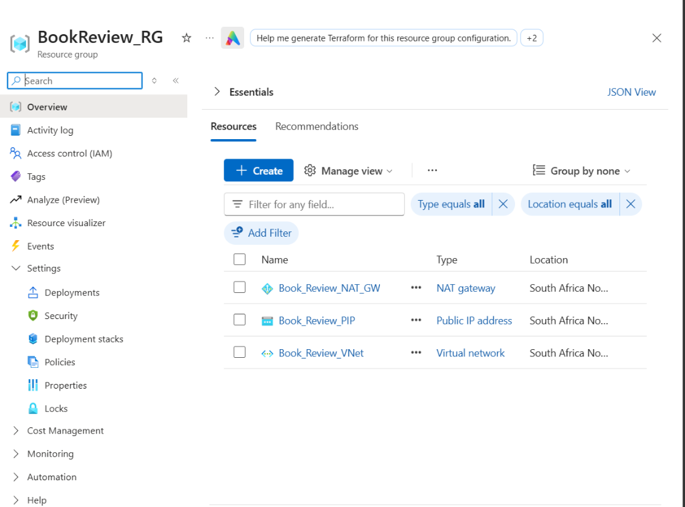

#### Screenshot 3: Virtual Network Subnet Configuration
Displays `Book_Review_VNet` subnets showing CIDR ranges, usable addresses (`251` for Web, `123` for App, `59` for DB), and delegation of `DB_Subnet` to `Microsoft.DBforMySQL/flexibleServers`.

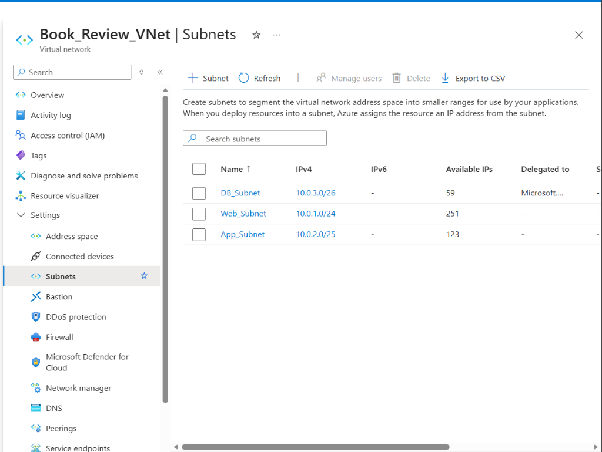

#### Screenshot 4: NAT Gateway Outbound Configuration & Subnet Association
Demonstrates the `Book_Review_NAT_GW` associated with the dedicated Public IP `Book_Review_PIP` (`4.221.200.108`) and attached to both `Web_Subnet` and `App_Subnet`.

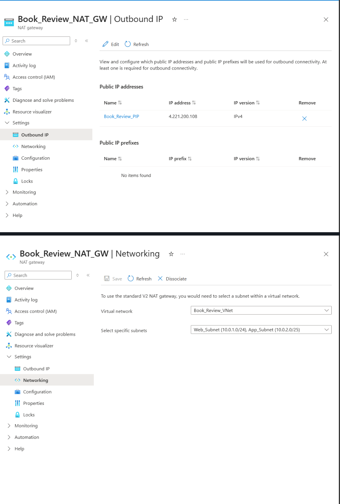

---

## Task 3: Security & Network Access Control

### 3.1 Network Security Group (NSG) Implementation Matrix
To enforce strict least-privilege network access between tiers, three dedicated Network Security Groups were created and associated directly to their respective subnets:

#### A. Web Tier NSG: `Web_NSG` (Associated to `Web_Subnet`)
* **Subnet Binding:** `Web_Subnet (10.0.1.0/24)`
* **Active Inbound Rules:**
  * **`SSH_and_HTTP` (Priority 100):** TCP ports `22, 80` allowed from source `*` (Any).  
    * *Engineering Context:* Allows public user HTTP access to port 80. For SSH administration during active staging across dynamic administrator IP locations, port 22 is permitted globally with mandatory SSH public key authentication (password authentication disabled at OS level).
  * **`Allow_LB_Probe_Web` (Priority 110):** TCP port `80` allowed from service tag `AzureLoadBalancer` to ensure reliable health check status monitoring.

#### B. Application Tier NSG: `App_NSG` (Associated to `App_Subnet`)
* **Subnet Binding:** `App_Subnet (10.0.2.0/25)`
* **Active Inbound Rules:**
  * **`Allow_3001_and_22` (Priority 100):** Ports `3001` (Express API) and `22` (SSH) allowed strictly from `10.0.1.0/24` (`Web_Subnet`).  
    * *Engineering Context:* Ensures zero external inbound connections can reach the backend. The API is reachable only from the Web tier, and SSH management is strictly constrained to the Bastion ProxyJump pathway originating from the Web VM.
  * **`Allow-LB-Probe-App` (Priority 110):** Port `3001` allowed from `AzureLoadBalancer` for Internal Load Balancer health verification.

#### C. Database Tier NSG: `DB_NSG` (Associated to `DB_Subnet`)
* **Subnet Binding:** `DB_Subnet (10.0.3.0/26)`
* **Active Inbound Rules:**
  * **`App_to_DB_rule` (Priority 100):** TCP port `3306` (MySQL) allowed strictly from `10.0.2.0/25` (`App_Subnet`).  
    * *Engineering Context:* Completely isolates the data tier from the web tier and public internet; only backend application instances residing within the application subnet CIDR can establish database sockets.

---

### 3.2 Web Virtual Machine Provisioning (`book-review-web-vm`)

The Web Virtual Machine functions as both the public presentation host and the administrative bastion jump host.

#### Configuration Profile:
* **VM Name:** `book-review-web-vm`
* **Resource Group:** `BookReview_RG`
* **Region:** `South Africa North`
* **Image:** Ubuntu Server 24.04 LTS - x64 Gen2
* **Compute Size:** `Standard_B2s_v2` (2 vCPUs, 4 GiB Memory)
* **Virtual Network:** `Book_Review_VNet`
* **Subnet:** `Web_Subnet` (`10.0.1.0/24`)
* **Private IP Address:** `10.0.1.4` (Static / Dynamic first host allocation)
* **Public IP Address:** `20.164.204.249` (Standard SKU, Static, `pip-book-review-web-vm`)
* **Authentication Method:** SSH Public Key (`azureuser`)
* **NIC Security Group:** None (delegated to subnet NSG `Web_NSG` for centralized rule enforcement)

---

### 3.3 Administrative Bastion & Secret Management Strategy

#### SSH ProxyJump Bastion Pathway
The App VM resides in `App_Subnet` with **no public IP address**. All administrative access is conducted via OpenSSH `ProxyJump` using the Web VM as a secure bastion:
```bash
# Connect securely to private App VM via Web VM Bastion (keys stay local)
ssh -i ~/.ssh/app-key.pem -J azureuser@20.164.204.249 azureuser@10.0.2.4
```
*Crucial Security Standard:* Private keys are never uploaded or stored on the intermediate Web VM. The Web VM acts strictly as an encrypted TCP pipe relaying traffic between the local admin workstation and the App VM.

#### Secret Management Baseline
1. Sensitive configuration items (MySQL credentials, JWT signing secrets, database host endpoints) are stored exclusively in local `.env` configuration files on each VM.
2. File permissions are restricted immediately upon creation:
   ```bash
   chmod 600 .env
   ```
   This ensures only the owning user process can read or modify application secrets.
3. Git repositories are guarded with comprehensive `.gitignore` rules to prevent credential leakage.

---

### 3.4 Verification & Evidence

#### Screenshot 5: Network Security Group Inbound Rules Comparison
Displays the verified inbound security rules configured across `Web_NSG`, `App_NSG`, and `DB_NSG`, enforcing least-privilege traffic boundaries.

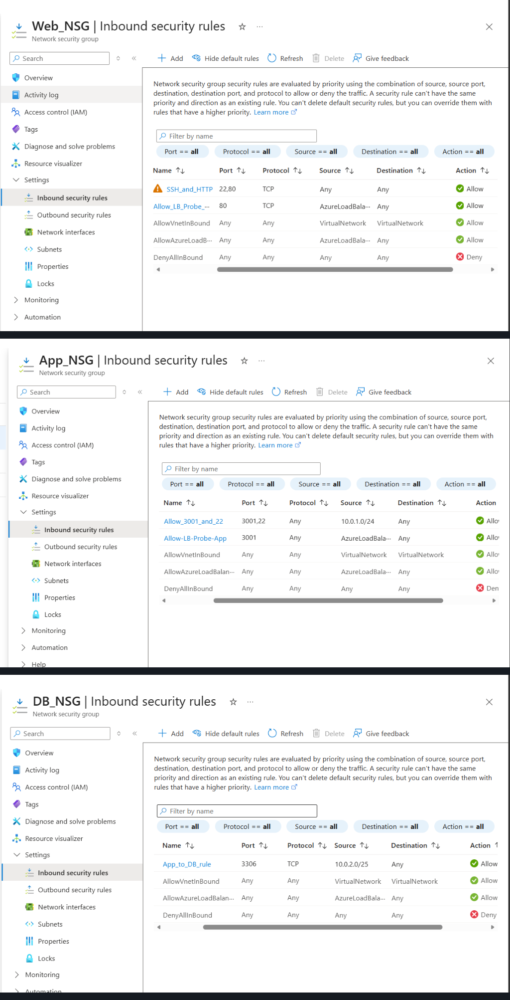

#### Screenshot 6: Web Virtual Machine Public IP & NIC Association
Displays `pip-book-review-web-vm` showing Public IP `20.164.204.249` bound to network interface `book-review-web-vm307` and Virtual Machine `book-review-web-vm`.

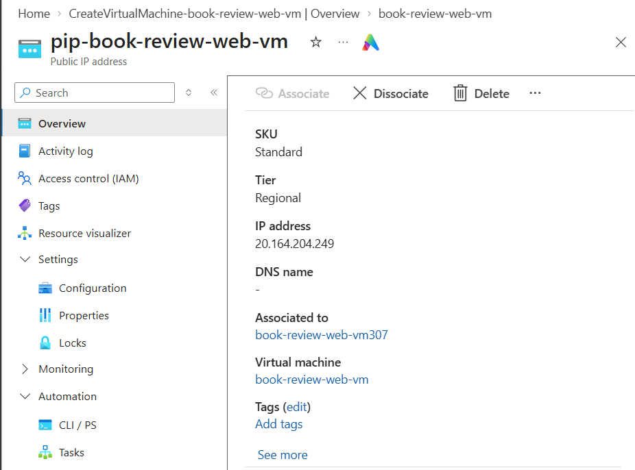

---

## Task 4: Deploy Managed Database Tier (Azure MySQL Flexible Server)

### 4.1 Overview & Architecture Rationale
Rather than maintaining an unmanaged MySQL installation on a self-hosted virtual machine, production enterprise standards mandate using **Azure Database for MySQL Flexible Server**.

Key technical advantages:
* **Private Network Isolation:** Bound to `DB_Subnet (10.0.3.0/26)` via VNet Integration, with **zero public endpoint**.
* **Private DNS Zone Integration:** Automatically provisions a private domain name (`book-review-db-jamiu.private.mysql.database.azure.com`) linked to `Book_Review_VNet` for secure intra-VNet name resolution.
* **Automated Backups & Recovery:** Point-in-time restoration capabilities.
* **In-Transit Encryption:** Enforces TLS 1.2+ encryption (`require_secure_transport = ON`) on TCP port 3306.

---

### 4.2 Configuration Parameters
* **Resource Group:** `BookReview_RG`
* **Server Name:** `book-review-db-jamiu`
* **Region:** `South Africa North`
* **Compute Tier:** Burstable (`Standard_B1ms` / General Purpose)
* **MySQL Engine Version:** 8.4 LTS
* **Connectivity Method:** **Private access (VNet Integration)**
* **Virtual Network:** `Book_Review_VNet`
* **Subnet:** `DB_Subnet (10.0.3.0/26)`
* **Private DNS Zone:** `book-review-db-jamiu.private.mysql.database.azure.com`
* **Enforced Encryption:** SSL/TLS enabled

---

### 4.3 Verification & Evidence

#### Screenshot 7: Database Server Overview
Displays the Azure Database for MySQL Flexible Server overview blade confirming server status `Ready`, MySQL version 8.4, and location `South Africa North`.

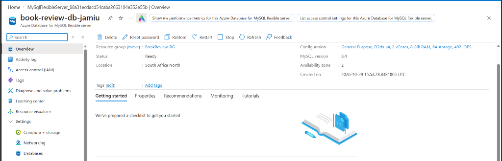

#### Screenshot 8: Database Networking & Private DNS Integration
Displays the database Networking blade confirming Private Access within `DB_Subnet` and active Private DNS Zone integration (`book-review-db-jamiu.private.mysql.database.azure.com`).

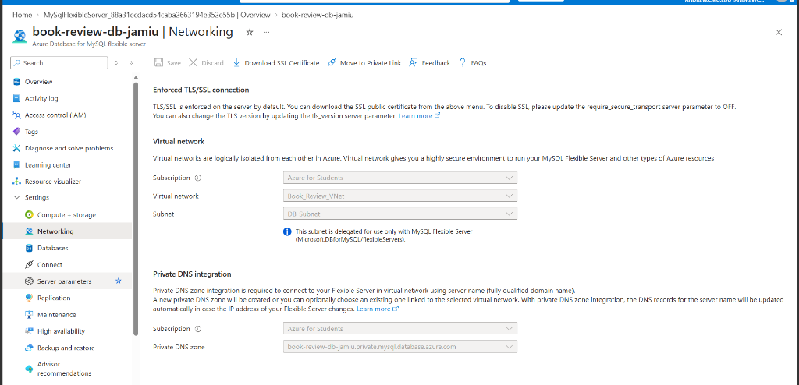

---

## Task 5: Deploy Application Tier (Private App VM)

### 5.1 Architecture & Provisioning
The Application VM hosts the Node.js/Express REST API and is completely shielded from public exposure.

#### Configuration Profile:
* **VM Name:** `book-review-app-vm`
* **Resource Group:** `BookReview_RG`
* **Region:** `South Africa North`
* **Image:** Ubuntu Server 24.04 LTS - x64 Gen2
* **Compute Size:** `Standard_B2ats_v2` (2 vCPUs, 1–2 GiB Memory)
* **Virtual Network:** `Book_Review_VNet`
* **Subnet:** `App_Subnet (10.0.2.0/25)`
* **Private IP Address:** `10.0.2.4`
* **Public IP Address:** **None** (Outbound egress handled via `Book_Review_NAT_GW` with Public IP `4.221.200.108`)
* **NIC Security Group:** None (delegated to subnet NSG `App_NSG`)

---

### 5.2 Verification & Evidence

#### Screenshot 9: Application VM Overview (Zero Public IP)
Displays `book-review-app-vm` running in `App_Subnet` with private IP `10.0.2.4` and no public IP assigned (outbound egress mapped exclusively to `Book_Review_NAT_GW`).

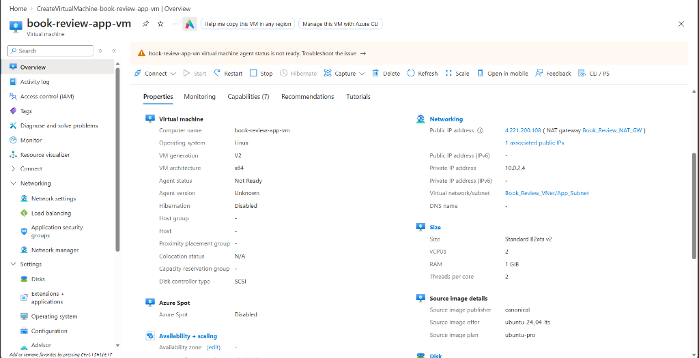

#### Screenshot 10: SSH ProxyJump Connection (Local Admin -> Web VM -> App VM)
Displays the successful SSH ProxyJump connection from the local administrator workstation jumping through `book-review-web-vm` (`20.164.204.249`) to the isolated `book-review-app-vm` (`10.0.2.4`).


#### Screenshot 11: MySQL Database Initialization & Least-Privilege User Creation
Displays the creation of the application database `book_review_db` and dedicated non-root user `bookreview_app` over the private Azure network interface (`10.0.3.4`).

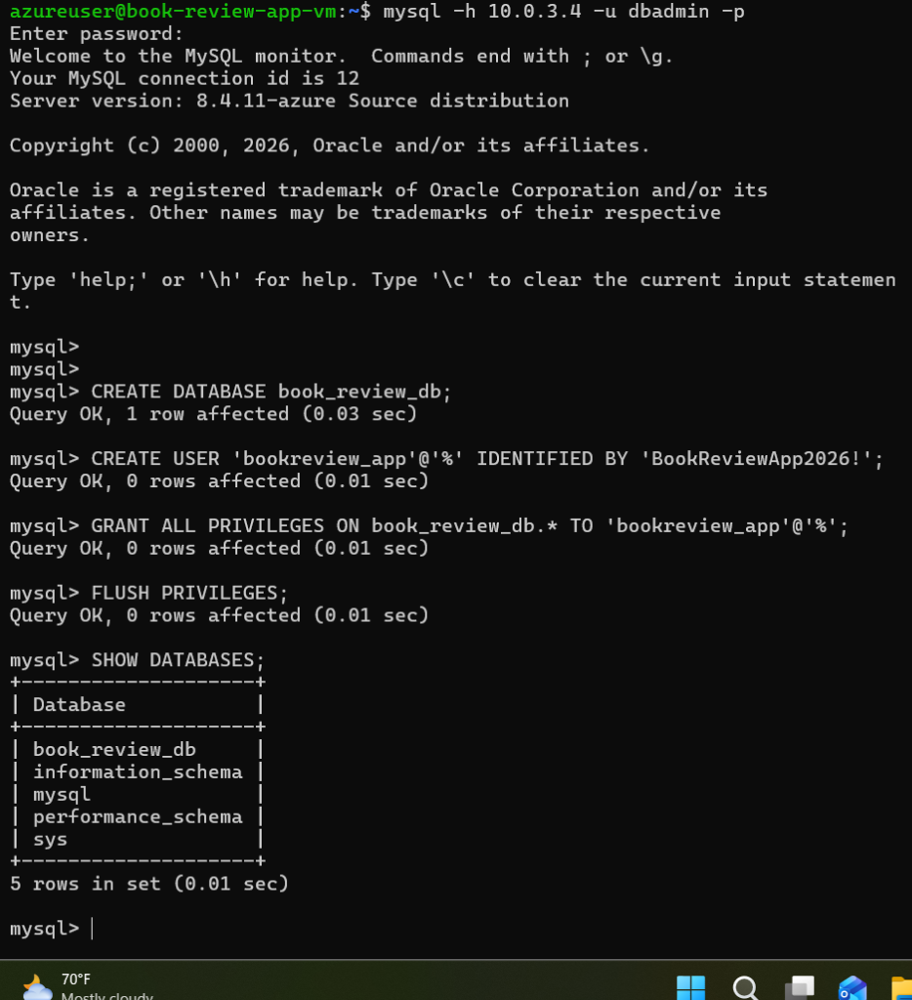

#### Screenshot 12: Backend Runtime & Local Health Probe (PM2 Process Supervision)
Displays the Express REST API supervised by PM2 (`online` status) and responding to a local health probe on port 3001 with `📚 Book Review API is running...`.

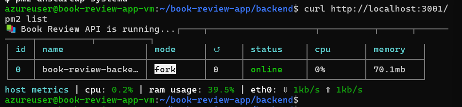

---

## Task 6: Deploy Presentation Tier (Web VM & Nginx Reverse Proxy)

### 6.1 Overview & Architecture Rationale
The Presentation Tier handles all client-facing traffic. It hosts:
1. **Next.js 15 Frontend:** Running locally on port `3000` (Server-Side Rendering and React client components).
2. **Nginx Reverse Proxy:** Listening on TCP port `80`, terminating public requests, and routing traffic:
   * Web pages (`/`) are forwarded to the local Next.js frontend (`http://127.0.0.1:3000`).
   * API requests (`/api/*`) are forwarded internally to the backend application endpoint (`http://10.0.2.10:3001` or App VM `http://10.0.2.4:3001`).

---

### 6.2 Verification & Evidence (Placeholders)

#### Screenshot 13: Next.js Production Build
*(Screenshot 13 placeholder - Next.js production build output and PM2 status on Web VM)*

#### Screenshot 14: Nginx Reverse Proxy Configuration
*(Screenshot 14 placeholder - Nginx site configuration forwarding port 80 to 3000 and /api to internal endpoint)*

#### Screenshot 15: Direct Web VM Verification
*(Screenshot 15 placeholder - Browser accessing Web VM public IP showing Book Review App)*

---

## Upcoming Implementation Phases (Tasks 7–8)

* **Task 7:** Configure Public Load Balancer (Port 80) and Internal Load Balancer (Port 3001), plus Azure Monitor diagnostic metrics and alerts.
* **Task 8:** End-to-end integration validation, database persistence verification, and controlled fault recovery test.

---

## Author & Engineering Profile

* **Engineer:** Jamiu Dahunsi  
* **Role:** Cloud & DevOps Engineer  
* **Specialization:** Enterprise Cloud Infrastructure, Network Security, Microservices & Three-Tier Deployments on Microsoft Azure
