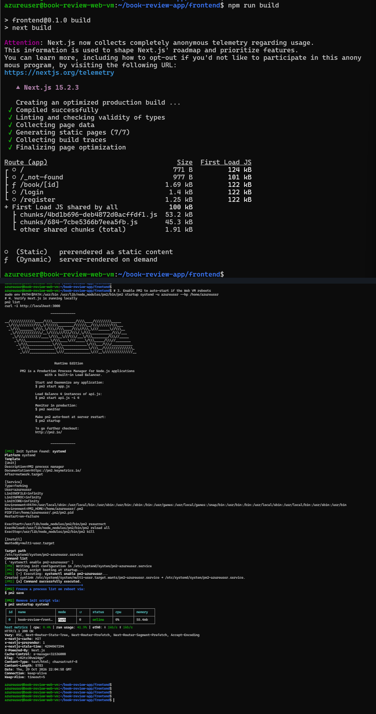
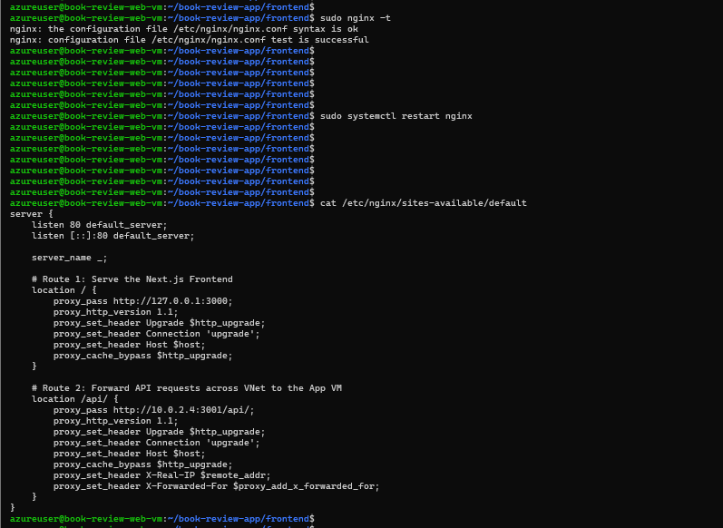
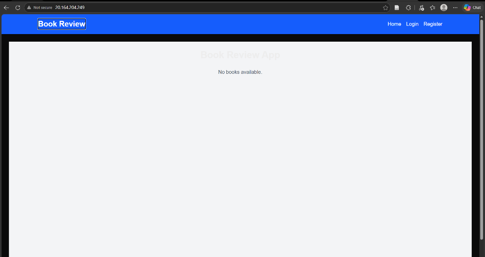
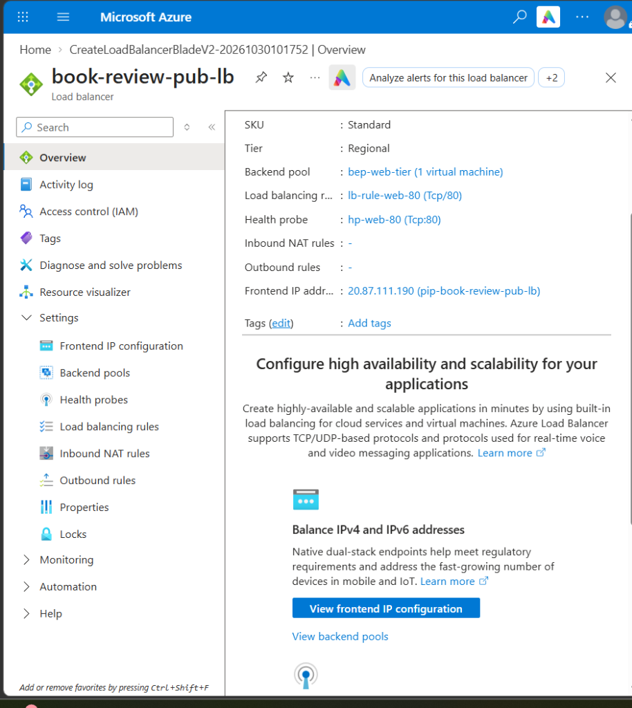
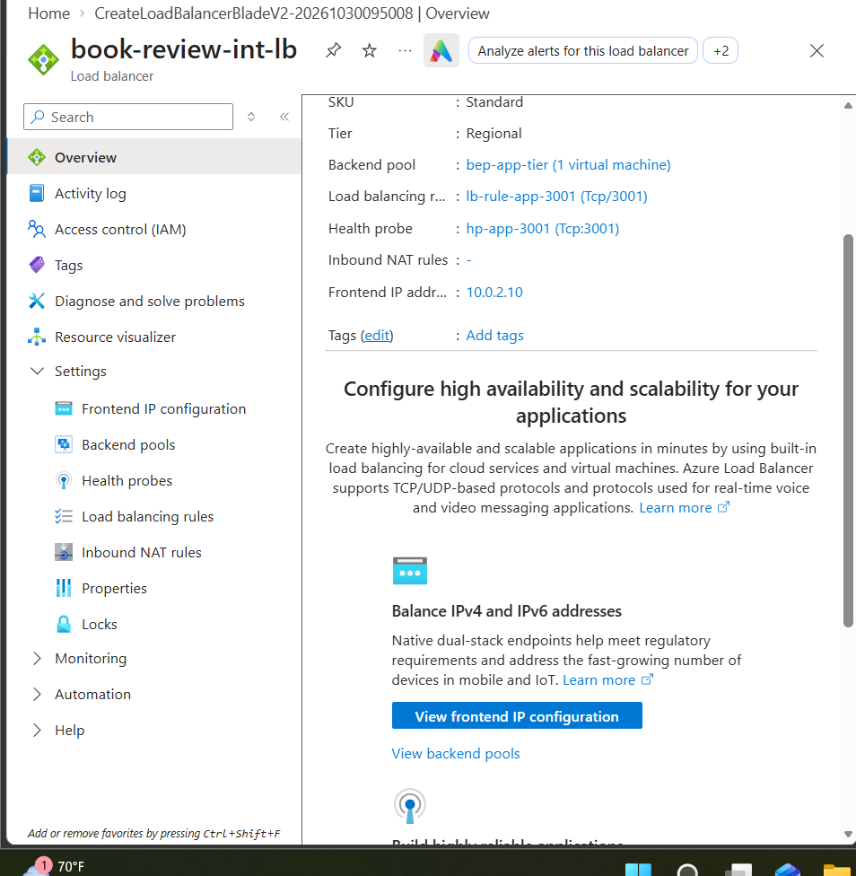
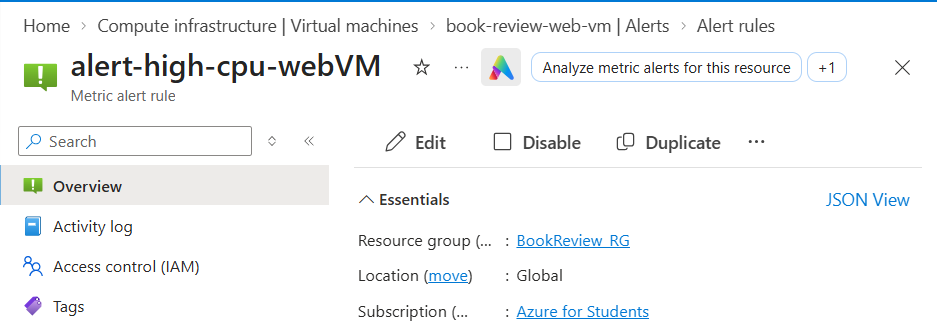
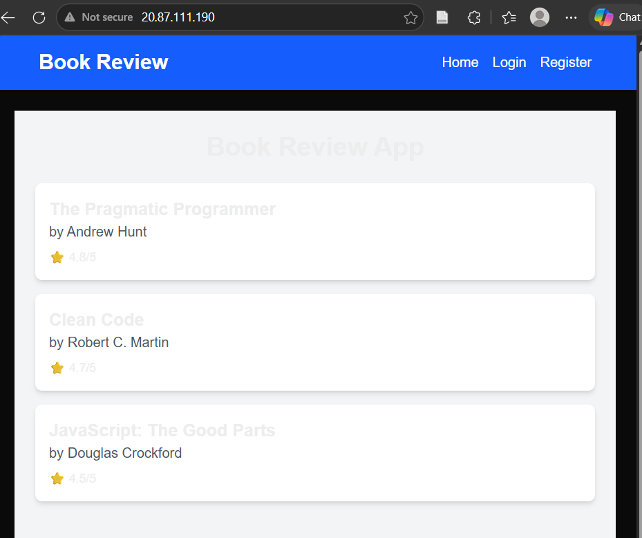
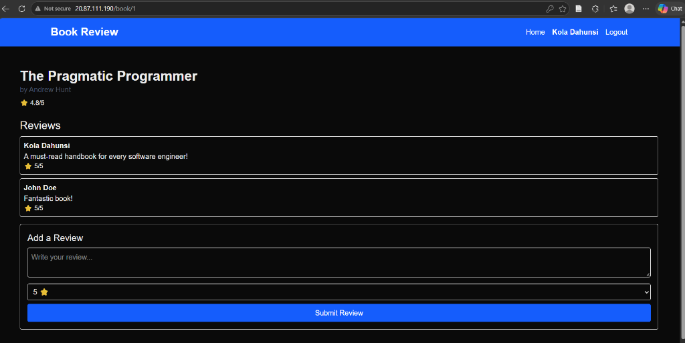
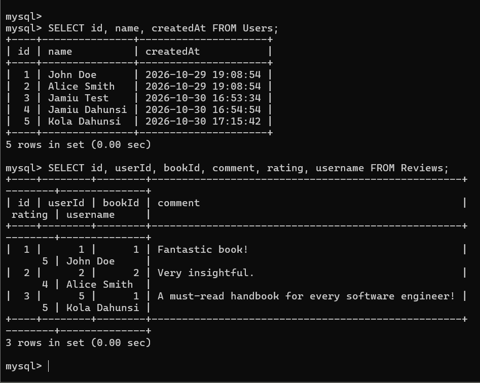
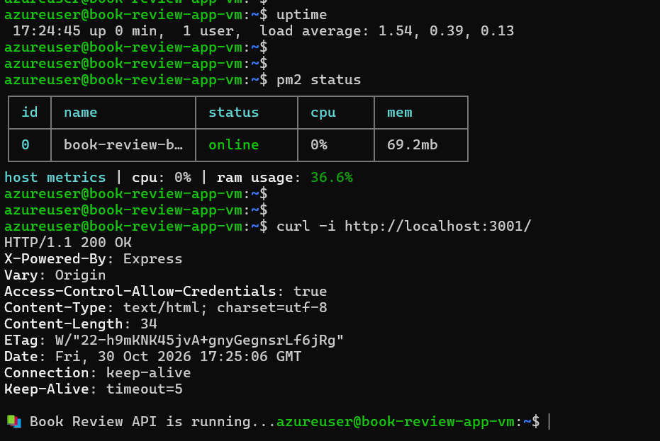

# Production Three-Tier Web Application on Microsoft Azure

[](https://azure.microsoft.com/)
[](https://ubuntu.com/)
[](https://nextjs.org/)
[](https://nodejs.org/)
[](https://azure.microsoft.com/)
[](https://nginx.org/)

---

## Table of Contents
1. [Project Overview and Objectives](#1-project-overview-and-objectives)
2. [End-to-End System Architecture](#2-end-to-end-system-architecture)
3. [Network Segmentation and IP Design](#3-network-segmentation-and-ip-design)
4. [Task 1: Architecture Blueprint and Technical Strategy](#task-1-architecture-blueprint-and-technical-strategy)
5. [Task 2: Virtual Network and Egress Infrastructure](#task-2-virtual-network-and-egress-infrastructure)
6. [Task 3: Network Security Groups and Web Tier Provisioning](#task-3-network-security-groups-and-web-tier-provisioning)
7. [Task 4: Managed Database Tier Deployment](#task-4-managed-database-tier-deployment)
8. [Task 5: Application Tier Deployment and Bastion Routing](#task-5-application-tier-deployment-and-bastion-routing)
9. [Task 6: Presentation Tier and Nginx Reverse Proxy](#task-6-presentation-tier-and-nginx-reverse-proxy)
10. [Task 7: Dual Load Balancers and Infrastructure Monitoring](#task-7-dual-load-balancers-and-infrastructure-monitoring)
11. [Task 8: End-to-End Validation, Data Persistence, and Fault Recovery](#task-8-end-to-end-validation-data-persistence-and-fault-recovery)
12. [Architectural Takeaways and Best Practices](#12-architectural-takeaways-and-best-practices)
13. [Author Profile](#author-profile)

---

## 1. Project Overview and Objectives

Enterprise production systems require strict separation of concerns across infrastructure layers. Direct internet access to application logic and database engines creates unnecessary exposure and complicates compliance.

This project delivers a complete three-tier deployment of a Book Review application on Microsoft Azure within the South Africa North region. The environment enforces zero direct public ingress to backend compute and data tiers, provides controlled outbound internet connectivity via an Azure NAT Gateway, balances incoming traffic through dual Azure Load Balancers (Public and Internal), and guarantees automated service recovery.

### Primary Objectives
* **Strict Network Segmentation:** Separate the presentation, application, and database workloads across dedicated subnets within a single Virtual Network (`10.0.0.0/16`).
* **Shielded Compute and Data:** The application VM has zero public IP addresses. The MySQL database operates exclusively through private endpoints inside a delegated subnet.
* **Controlled Ingress:** All user traffic enters strictly through an Azure Standard Public Load Balancer on TCP port 80.
* **Controlled Egress:** All outbound connections for operating system updates, package downloads, and repository access route through an Azure NAT Gateway. Unsolicited inbound traffic from the internet is dropped by default.
* **Secure Bastion Administration:** Direct SSH access is restricted to the Web VM. The private Application VM is managed exclusively via an OpenSSH ProxyJump bastion pattern, keeping private keys on the administrator workstation.
* **Inter-Tier Private Load Balancing:** Decouple the web frontend and API tier using an internal Azure Load Balancer configured with a private static frontend IP (`10.0.2.10:3001`).
* **Resilience and Auto-Healing:** Ensure services restart automatically on system reboot through systemd and PM2 process supervision.

---

## 2. End-to-End System Architecture

### Architectural Topology Diagram
The diagram below illustrates the network perimeter, subnet layout, security rules, and request flows through the three tiers.


### Request and Network Flow Summary
```mermaid
flowchart TD
    subgraph Internet ["Public Internet"]
        User["End-User Client Browser"]
        Admin["DevOps Workstation (Admin)"]
    end

    subgraph Azure ["Microsoft Azure Cloud (South Africa North) | Resource Group: BookReview_RG"]
        subgraph VNet ["Virtual Network: Book_Review_VNet (10.0.0.0/16)"]
            
            subgraph WebTier ["Presentation Tier: Web_Subnet (10.0.1.0/24)"]
                PubLB["Azure Public Load Balancer<br/>Frontend IP: 20.87.111.190 :80"]
                WebVM["Web VM: book-review-web-vm (10.0.1.4)<br/>Nginx Reverse Proxy (:80)<br/>Next.js 15 Runtime (:3000)"]
            end

            subgraph AppTier ["Application Tier: App_Subnet (10.0.2.0/25)"]
                IntLB["Azure Internal Load Balancer<br/>Private Frontend IP: 10.0.2.10 :3001"]
                AppVM["App VM: book-review-app-vm (10.0.2.4)<br/>No Public IP<br/>Node.js Express API (:3001)<br/>Supervised by PM2"]
            end

            subgraph DBTier ["Data Tier: DB_Subnet (10.0.3.0/26)"]
                MySQL["Azure Database for MySQL Flexible Server<br/>Private IP: 10.0.3.4 :3306<br/>Private DNS Integration<br/>Mandatory TLS/SSL Encryption"]
            end

            NAT["Azure NAT Gateway: Book_Review_NAT_GW<br/>Public IP: 4.221.200.108<br/>Secure Egress for Web and App Subnets"]
        end
    end

    %% Inbound Ingress
    User -->|HTTP TCP 80| PubLB
    PubLB -->|Route TCP 80| WebVM
    WebVM -->|Local Loopback Proxy :3000| WebVM
    WebVM -->|API Calls /api/* :3001| IntLB
    IntLB -->|Route TCP 3001| AppVM
    AppVM -->|MySQL Protocol :3306 (TLS Enforced)| MySQL

    %% Outbound Egress
    WebVM -.->|Outbound Updates Only| NAT
    AppVM -.->|Outbound Updates Only| NAT

    %% Administration
    Admin -->|SSH TCP 22 Direct| WebVM
    Admin -.->|SSH ProxyJump via Web VM| AppVM
```

---

## 3. Network Segmentation and IP Design

The Virtual Network uses the CIDR block `10.0.0.0/16`. Subnet boundaries were allocated according to tier requirements, private endpoint delegation rules, and Azure internal reservations.

| Subnet Name | CIDR Block | Total Addresses | Azure Reserved | Usable Addresses | Associated Workloads | Assigned NSG | Subnet Delegation |
| :--- | :--- | :--- | :--- | :--- | :--- | :--- | :--- |
| **`Web_Subnet`** | `10.0.1.0/24` | 256 | 5 | 251 | Public Load Balancer backend pool, Web VM (`10.0.1.4`) | `Web_NSG` | None |
| **`App_Subnet`** | `10.0.2.0/25` | 128 | 5 | 123 | Internal Load Balancer frontend (`10.0.2.10`), Private App VM (`10.0.2.4`) | `App_NSG` | None |
| **`DB_Subnet`** | `10.0.3.0/26` | 64 | 5 | 59 | Azure MySQL Flexible Server private endpoint (`10.0.3.4`) | `DB_NSG` | `Microsoft.DBforMySQL/flexibleServers` |

Azure reserves five IP addresses in each subnet:
* `.0`: Network address.
* `.1`: Default gateway address.
* `.2` and `.3`: Azure DNS mapping addresses.
* `.255`: Broadcast address.

---

## Task 1: Architecture Blueprint and Technical Strategy

### 1.1 Technical Decisions
* **Target Cloud Region:** South Africa North (`southafricanorth`). Selected for burstable VM capacity (`Standard_B2s_v2` and `Standard_B2ats_v2`), availability of MySQL Flexible Server burstable compute (`Standard_B1ms`), and low latency.
* **Compute Capacity Planning:** Ubuntu 24.04 LTS instances running on dual-core burstable virtual machines. This tier provides sufficient RAM and burstable CPU credits to compile Next.js production bundles and handle Node.js Express workloads reliably.
* **High Availability Considerations:** One VM is provisioned per compute tier for this capstone implementation. Azure Standard Load Balancers monitor both hosts via TCP health probes. While a single host per tier introduces a brief maintenance window during restarts, the architecture is designed to scale horizontally using Virtual Machine Scale Sets (VMSS) across multiple Availability Zones without requiring code changes.
* **Database Isolation and Integrity:** Managed Azure Database for MySQL Flexible Server provisioned with 32 GiB storage and 1-day automated point-in-time recovery backup retention. Enforced SSL/TLS encryption (`require_secure_transport = ON`) protects data in transit between the application tier and the database.
* **Secret Management Strategy:** All database passwords, tokens, and endpoints are maintained in local `.env` configuration files with strict file permissions (`chmod 600`), owned by the application service user. Sensitive values are excluded from version control using `.gitignore`.

### 1.2 Evidence
#### Screenshot 1: Complete Architecture Blueprint
The comprehensive architecture diagram showing the entire network layout, security boundaries, and communication paths.


---

## Task 2: Virtual Network and Egress Infrastructure

### 2.1 Provisioned Resources
1. **Resource Group:** `BookReview_RG` created in region `southafricanorth`.
2. **Virtual Network:** `Book_Review_VNet` provisioned with address space `10.0.0.0/16`.
3. **Subnets:**
   * `Web_Subnet`: `10.0.1.0/24`
   * `App_Subnet`: `10.0.2.0/25`
   * `DB_Subnet`: `10.0.3.0/26`, delegated to `Microsoft.DBforMySQL/flexibleServers`
4. **Internal Static IP Reservation:** Static IP `10.0.2.10` reserved in `App_Subnet` for the Internal Load Balancer frontend.
5. **Azure NAT Gateway:** `Book_Review_NAT_GW` created with static public IP `Book_Review_PIP` (`4.221.200.108`) and associated with both `Web_Subnet` and `App_Subnet`. This allows the private App VM to fetch OS patches and dependencies securely without exposing an inbound public IP.

### 2.2 Evidence
#### Screenshot 2: Resource Group Overview
Shows `BookReview_RG` with the provisioned VNet, NAT Gateway, and Public IP.


#### Screenshot 3: Virtual Network Subnet Configuration
Displays the three subnets, their CIDR ranges, available IP allocations, and the database delegation on `DB_Subnet`.


#### Screenshot 4: NAT Gateway Outbound Configuration
Shows `Book_Review_NAT_GW` associated with public IP `4.221.200.108` and linked to `Web_Subnet` and `App_Subnet`.


---

## Task 3: Network Security Groups and Web Tier Provisioning

### 3.1 Network Security Group Rules

#### Web Tier: `Web_NSG` (Bound to `Web_Subnet`)
* **Rule 100 (`SSH_and_HTTP`):** Allows TCP ports 22 and 80 from source `*`. Port 80 serves public web traffic. Port 22 provides SSH access for administration with mandatory key-based authentication (passwords disabled at OS level).
* **Rule 110 (`Allow_LB_Probe_Web`):** Allows TCP port 80 from service tag `AzureLoadBalancer` for load balancer health probes.

#### Application Tier: `App_NSG` (Bound to `App_Subnet`)
* **Rule 100 (`Allow_3001_and_22`):** Allows TCP ports 3001 and 22 strictly from `10.0.1.0/24` (`Web_Subnet`). No traffic from the public internet can reach this subnet. SSH administration is constrained to the Web VM bastion route.
* **Rule 110 (`Allow-LB-Probe-App`):** Allows TCP port 3001 from `AzureLoadBalancer` for Internal Load Balancer health verification.

#### Database Tier: `DB_NSG` (Bound to `DB_Subnet`)
* **Rule 100 (`App_to_DB_rule`):** Allows TCP port 3306 (MySQL) strictly from source `10.0.2.0/25` (`App_Subnet`). Direct connections from the web tier or the public internet are blocked.

### 3.2 Web Virtual Machine Profile (`book-review-web-vm`)
* **Size:** `Standard_B2s_v2` / `Standard_B2ats_v2` (2 vCPUs, Ubuntu 24.04 LTS)
* **Private IP:** `10.0.1.4` (in `Web_Subnet`)
* **Public IP:** `20.164.204.249` (Standard static allocation)
* **Authentication:** SSH public key (`azureuser`)

### 3.3 Bastion Access Pattern
Because `book-review-app-vm` has no public IP address, all administrative access uses an OpenSSH ProxyJump command:
```bash
ssh -i ~/.ssh/app-key.pem -o "ProxyCommand=ssh -i ~/.ssh/web-key.pem -W %h:%p azureuser@20.164.204.249" azureuser@10.0.2.4
```
Private keys remain exclusively on the local workstation. The intermediate Web VM functions solely as an encrypted TCP relay.

### 3.4 Evidence
#### Screenshot 5: Network Security Group Rules
Displays the verified inbound rules for `Web_NSG`, `App_NSG`, and `DB_NSG`.


#### Screenshot 6: Web VM Overview
Displays `book-review-web-vm` with public IP `20.164.204.249` and private IP `10.0.1.4`.


---

## Task 4: Managed Database Tier Deployment

### 4.1 Azure Database for MySQL Flexible Server
A managed MySQL Flexible Server was chosen over a self-hosted VM database to ensure automated backups, built-in high availability, and automated maintenance patching.

* **Server Name:** `book-review-db-jamiu`
* **Private Endpoint IP:** `10.0.3.4` (in `DB_Subnet`)
* **MySQL Version:** 8.4 LTS
* **Compute Tier:** Burstable `Standard_B1ms`
* **Private DNS Zone:** `book-review-db-jamiu.private.mysql.database.azure.com`
* **Encryption in Transit:** Enforced TLS 1.2+ (`require_secure_transport = ON`)

### 4.2 Evidence
#### Screenshot 7: MySQL Server Overview
Displays `book-review-db-jamiu` with server status `Ready`, MySQL version 8.4, and location `South Africa North`.


#### Screenshot 8: MySQL Private Networking and DNS Integration
Displays the Networking blade confirming Private Access inside `DB_Subnet` and active Private DNS Zone integration.


---

## Task 5: Deploy Application Tier (Private App VM)

### 5.1 Application VM Profile (`book-review-app-vm`)
* **Private IP:** `10.0.2.4` (in `App_Subnet`)
* **Public IP:** None (zero public exposure)
* **Outbound Connectivity:** Routed via `Book_Review_NAT_GW` (`4.221.200.108`)
* **Runtime:** Node.js 20, Express REST API, Sequelize ORM
* **Process Supervision:** PM2 daemon configured with systemd auto-start

### 5.2 Database Initialization
Using the SSH ProxyJump pathway, the private application server connected to MySQL on `10.0.3.4`. A dedicated database `book_review_db` and non-root user `bookreview_app` were initialized with restricted permissions.

### 5.3 Evidence
#### Screenshot 9: Application VM Overview (No Public IP)
Displays `book-review-app-vm` in `App_Subnet` with private IP `10.0.2.4` and no public IP assigned.


#### Screenshot 10: SSH ProxyJump Bastion Connection
Shows the terminal session connecting from the workstation through the Web VM to the private App VM.


#### Screenshot 11: MySQL Database and Application User Initialization
Shows the SQL commands creating `book_review_db` and granting least-privilege rights to `bookreview_app`.


#### Screenshot 12: Backend Runtime and Health Check
Shows PM2 managing `book-review-backend` in `online` status and responding with `HTTP/1.1 200 OK` on port 3001.


---

## Task 6: Deploy Presentation Tier (Web VM & Nginx Reverse Proxy)

### 6.1 Presentation Architecture
The web tier hosts:
1. **Next.js 15 Frontend:** Running locally on port 3000, managed by PM2.
2. **Nginx Reverse Proxy:** Listening on TCP port 80:
   * Root requests (`/`) are forwarded to the local Next.js frontend (`http://127.0.0.1:3000`).
   * API requests (`/api/*`) are forwarded across the virtual network to the Internal Load Balancer on `http://10.0.2.10:3001`.

### 6.2 Evidence
#### Screenshot 13: Next.js Production Build and PM2 Supervision
Shows `npm run build` completing successfully and PM2 running `book-review-frontend` on port 3000.



#### Screenshot 14: Nginx Reverse Proxy Configuration
Shows the Nginx virtual host configuration routing frontend traffic to port 3000 and API traffic to the internal backend.



#### Screenshot 15: Direct Web VM Verification
Shows the browser accessing `http://20.164.204.249` directly during initial staging.



---

## Task 7: Configure Dual Load Balancers and Infrastructure Monitoring

### 7.1 Load Balancer Topology

1. **Public Load Balancer (`book-review-pub-lb`):**
   * **Role:** External ingress entry point.
   * **Frontend:** Public IP `20.87.111.190` (`pip-book-review-pub-lb`).
   * **Backend Pool:** `bep-web-tier` (`book-review-web-vm` / `10.0.1.4`).
   * **Health Probe:** TCP Port 80 (`hp-web-80`).
   * **Load Balancing Rule:** `lb-rule-web-80` (TCP 80 to 80).

2. **Internal Load Balancer (`book-review-int-lb`):**
   * **Role:** Private inter-tier traffic distribution between presentation and application tiers.
   * **Frontend:** Private Static IP `10.0.2.10` in `App_Subnet`.
   * **Backend Pool:** `bep-app-tier` (`book-review-app-vm` / `10.0.2.4`).
   * **Health Probe:** TCP Port 3001 (`hp-app-3001`).
   * **Load Balancing Rule:** `lb-rule-app-3001` (TCP 3001 to 3001).

3. **Infrastructure Monitoring Rule:**
   * Configured an Azure Monitor metric alert rule named `alert-high-cpu-webVM` on `book-review-web-vm` to trigger when CPU usage exceeds 80 percent over a 5-minute evaluation window.

### 7.2 Evidence
#### Screenshot 16: Public Load Balancer Configuration
Displays `book-review-pub-lb` overview with public frontend IP `20.87.111.190`, backend pool `bep-web-tier`, health probe on port 80, and load balancing rule `lb-rule-web-80`.



#### Screenshot 17: Internal Load Balancer Configuration
Displays `book-review-int-lb` overview with private frontend IP `10.0.2.10`, backend pool `bep-app-tier`, health probe on port 3001, and load balancing rule `lb-rule-app-3001`.



#### Screenshot 18: Azure Monitor Metric Alert Rule
Displays the configured metric alert rule `alert-high-cpu-webVM` monitoring percentage CPU on `book-review-web-vm`.



---

## Task 8: End-to-End Validation, Data Persistence, and Fault Recovery

### 8.1 Complete Request Lifecycle
The end-to-end request flow operates as follows:
1. **Client Ingress:** The user browser opens `http://20.87.111.190`.
2. **Web Tier Routing:** The Public Load Balancer forwards traffic to Nginx on `book-review-web-vm` (`10.0.1.4`). Next.js renders the frontend layout and issues client API calls to `/api/*`.
3. **Internal Proxying:** Nginx captures requests to `/api/*` and proxies them across the virtual network to the Internal Load Balancer private frontend (`10.0.2.10:3001`).
4. **Application Processing:** The Internal Load Balancer delivers traffic to the Express API on `book-review-app-vm` (`10.0.2.4`).
5. **Database Execution:** Express queries MySQL on `10.0.3.4` over an encrypted TLS connection and returns JSON payloads to the browser.

### 8.2 Evidence
#### Screenshot 19: Public Load Balancer Application Access
Displays the browser loading `http://20.87.111.190` through `book-review-pub-lb`. The Next.js frontend retrieves and renders book cards (`The Pragmatic Programmer`, `Clean Code`, `JavaScript: The Good Parts`) from the database tier.



#### Screenshot 20: User Review Submission
Displays the book details page (`http://20.87.111.190/book/1`) after user authentication as Kola Dahunsi. A 5-star review with comment (`A must-read handbook for every software engineer!`) is submitted and immediately rendered in the reviews list.



#### Screenshot 21: Database Persistence Verification
Direct SQL query output executed from `book-review-app-vm` against `book-review-db-jamiu` (`10.0.3.4`) confirming data persistence:
* The `Users` table contains user ID 5 (`Kola Dahunsi`).
* The `Reviews` table contains review ID 3 linked to user ID 5 with the submitted review text.



#### Screenshot 22: Controlled Fault Recovery Test
Demonstrates system resilience following a controlled reboot (`sudo reboot`) on `book-review-app-vm`:
* `uptime` confirms the system recently restarted (`up 0 min`).
* `pm2 status` confirms `book-review-backend` was automatically brought back to `online` status via the systemd service.
* `curl -i http://localhost:3001/` confirms local API health returning `HTTP/1.1 200 OK`.



---

## 12. Architectural Takeaways and Best Practices

1. **Azure Load Balancer Loopback (Hairpinning) Rule:** A virtual machine that is a backend pool member of an Internal Load Balancer cannot query the load balancer frontend IP to connect to itself. Azure drops these packets by design. Health checks and route verifications to an internal load balancer must always be executed from a different virtual machine (e.g. from the Web VM).
2. **Next.js Client-Side Environment Variables:** In Next.js client bundles, `NEXT_PUBLIC_*` environment variables are baked into static JavaScript files during compilation (`npm run build`). Setting them in a runtime `.env` file without rebuilding the application leaves client requests targeting empty or default hostnames.
3. **Memory Management on Burstable Instances:** On 1 GiB virtual machine instances, compilation steps can trigger the Linux Out-Of-Memory (OOM) killer. Configuring a 2 GiB swapfile provides adequate overhead for compilation tasks without requiring larger VM sizes.
4. **Least-Privilege Database Access:** Restricting MySQL database access to a dedicated application user (`bookreview_app`) limited to a specific private subnet CIDR guarantees that a compromised web server cannot access the database directly.

---

## Author Profile

* **Engineer:** Jamiu Dahunsi
* **Role:** Cloud and DevOps Engineer
* **Focus Areas:** Enterprise Cloud Architecture, Infrastructure Security, Networking, and Containerized Deployments on Microsoft Azure
